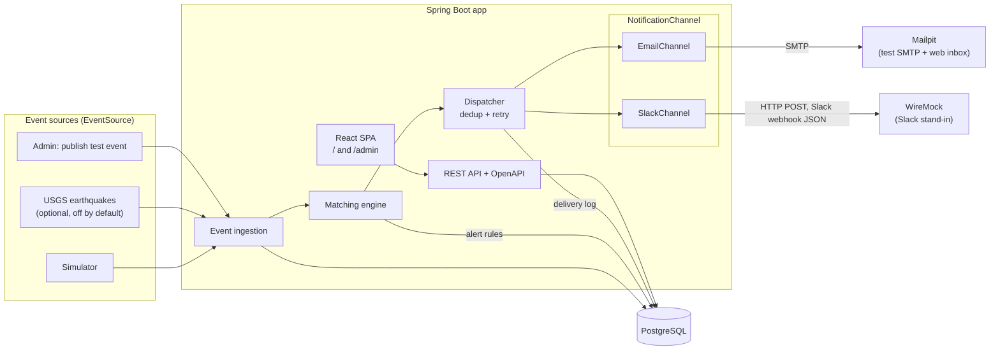
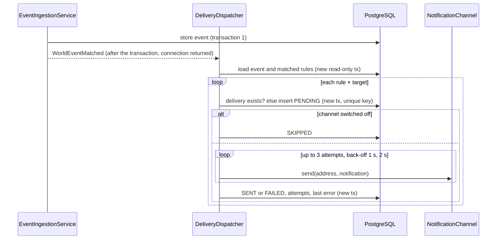
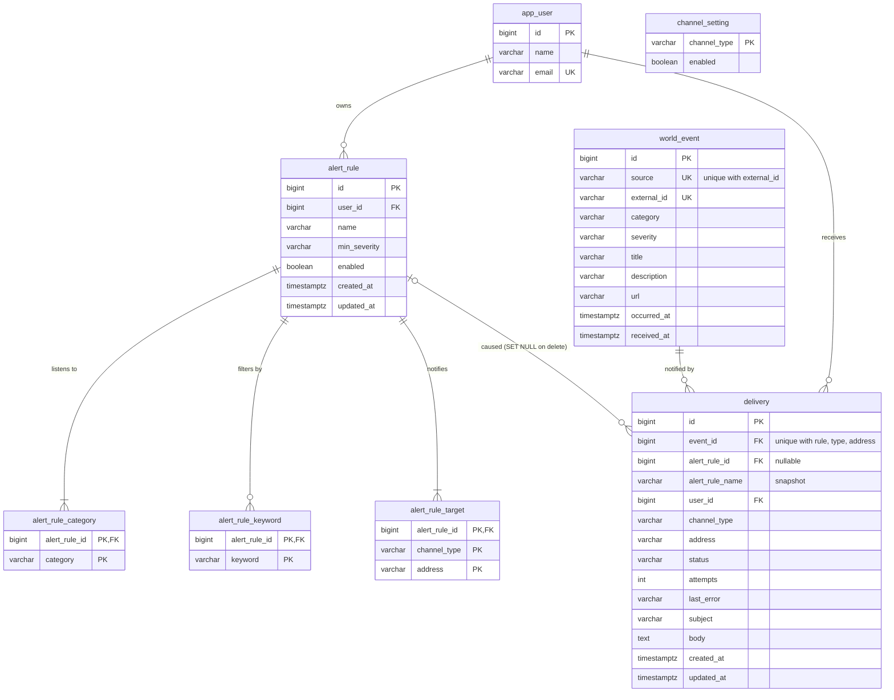

# Architecture

> **Status: M4.** Implemented: users and alert rules (M1); event sources, ingestion and matching (M2); notification channels, delivery and the delivery log (M3); the user web app (M4). Still planned: the admin UI (M5) and the app container in the compose stack (M6). Each section says which. This document is updated at every milestone to match the code.

## Overview



## Flow of one event

All six steps are implemented (steps 1–3 in M2, steps 4–6 in M3).

1. `EventPoller` asks each enabled `EventSource` for events at the source's interval (or an admin publishes one through `POST /api/admin/events`). Both paths call `EventIngestionService.ingest`.
2. The event is stored once: a repeat with the same `(source, externalId)` is skipped, and a unique constraint backs this up in the database.
3. `AlertRuleRepository.findEnabledByCategory` loads the enabled rules for the event's category; `AlertMatcher` keeps those whose minimum severity is at or below the event's severity and whose keywords (if any) appear in the title or description. If any match, a `WorldEventMatched(eventId, alertRuleIds)` application event is published.
4. After the ingestion transaction has completed and returned its database connection, `DeliveryDispatcher` receives `WorldEventMatched`. For every target of every matched rule it formats the message (`NotificationFormatter`) and creates a `PENDING` row in the delivery log. If a row for the same (event, rule, channel type, address) already exists, that target is skipped: this is the de-duplication.
5. If the admin switched the channel off, the delivery becomes `SKIPPED`. Otherwise the `NotificationChannel` for the target's type sends it (SMTP for email, HTTP POST for Slack). A failure is retried: up to 3 attempts, waiting 1 s, then 2 s.
6. The outcome (`SENT` or `FAILED`, attempts, last error) is saved on the same row, which also holds the exact subject and body. Users see these rows as their notification history, admins as the delivery log.



Every database step runs in its own short transaction and no transaction or connection is held during a network call, so a delivery uses at most one database connection at a time ([`decisions.md`](decisions.md) ADR-023; this was not true in the first M3 version, see [`review-log.md`](review-log.md) R7). Dispatch is synchronous: the thread that ingested the event also sends the notifications ([`tradeoffs.md`](tradeoffs.md) T19).

## Implemented so far (M1–M4)

### Code layout

The backend is organized by feature (package-by-feature), not by technical layer, so each folder holds everything about one concept.

```
backend/src/main/java/io/github/kisligi/alerts/
├── WorldEventAlertsApplication.java   entry point
├── common/      shared enums (EventCategory, Severity, ChannelType), exceptions,
│                RFC 9457 error mapping (ApiExceptionHandler), OpenAPI info,
│                HTTP client settings (HTTP/1.1, timeouts)
├── user/        AppUser entity, repository, GET /api/users
├── alert/       AlertRule entity, ChannelTarget, validation, service, REST controller
├── event/       WorldEvent entity, ingestion service, WorldEventMatched, events REST API
│   └── source/  EventSource interface, simulator, USGS adapter, poller, source config
├── matching/    AlertMatcher: the matching rules in one place
├── channel/     NotificationChannel interface, EmailChannel, SlackChannel,
│                channel on/off settings and their admin API
└── delivery/    DeliveryDispatcher (dedup, retries), NotificationFormatter,
                 Delivery entity (the delivery log), notification and delivery-log API
backend/src/main/resources/
├── application.yaml                   config; every value overridable by env var
└── db/migration/                      Flyway: V1 users and rules, V2 demo users, V3 events,
                                       V4 deliveries and channel settings
infra/wiremock/mappings/               Slack stand-in stubs, shared by compose and the tests
```

### REST API

Interactive documentation: Swagger UI at `/swagger-ui.html`, OpenAPI JSON at `/v3/api-docs`.

| Method | Path | What it does |
|--------|------|--------------|
| GET | `/api/users` | List the seeded demo users |
| GET | `/api/users/{userId}/alerts` | List a user's alert rules |
| POST | `/api/users/{userId}/alerts` | Create an alert rule (201 + `Location`) |
| GET | `/api/alerts/{id}` | Get one alert rule |
| PUT | `/api/alerts/{id}` | Replace an alert rule (also used to enable/disable it) |
| DELETE | `/api/alerts/{id}` | Delete an alert rule (204) |
| GET | `/api/events?limit=50` | Most recent events, newest first (`limit` 1–200) |
| POST | `/api/admin/events` | Publish a test event; runs the normal ingestion, matching and delivery and returns the matched rule ids (201) |
| GET | `/api/users/{userId}/notifications?limit=50` | A user's notification history, newest first (`limit` 1–200) |
| GET | `/api/admin/deliveries?status=FAILED&limit=100` | The delivery log for all users, newest first; optional `status` filter (`limit` 1–500) |
| GET | `/api/admin/channels` | Each channel type: switched on or off, and whether it has an implementation |
| PUT | `/api/admin/channels/{type}` | Switch a channel on or off globally: `{"enabled": false}` |

Errors use RFC 9457 problem details (`application/problem+json`) everywhere, including Spring's own errors such as malformed JSON or an out-of-range query parameter: 400 with an `errors` list for body validation failures, 400 for an address that does not fit its channel, 404 for unknown users or rules.

Validation rules: at most 50 rules per user (`ALERTS_MAX_RULES_PER_USER`, ADR-029); name required (≤ 100 chars); at least one category; at most 20 keywords; minimum severity required; 1–10 targets. An `EMAIL` target must look like an email address; a `SLACK` target must be an `http(s)` URL (plain `http` is allowed for the local Slack stand-in). Keywords are trimmed, lower-cased and de-duplicated.

### Event sources

| Source | Default | Interval | What it produces |
|--------|---------|----------|------------------|
| `SimulatedEventSource` (`SIMULATOR`) | on | 15 s | one random event from a 12-entry catalog that covers every category × severity, labelled `[SIMULATED]` |
| `UsgsEarthquakeSource` (`USGS`) | off | 5 min | real earthquakes from the USGS 4.5+ past-day GeoJSON feed; severity from magnitude: < 5 LOW, < 6 MEDIUM, < 7 HIGH, ≥ 7 CRITICAL |
| Admin API (`ADMIN`) | always | on demand | whatever the admin publishes |

A failing source is logged and retried at its next poll; it never stops other sources. One event that cannot be stored never stops the rest of its batch.

### Channels and delivery

| Channel | Address | How it sends | Local stand-in |
|---------|---------|--------------|----------------|
| `EmailChannel` (`EMAIL`) | email address | SMTP via Spring's `JavaMailSender`, plain text, from `ALERTS_EMAIL_FROM` | Mailpit: inbox at http://localhost:8025 |
| `SlackChannel` (`SLACK`) | Slack incoming-webhook URL | HTTP POST of `{"text": "*subject*\nbody"}` | WireMock at http://localhost:8089: `/services/...` returns 200, `/services/fail/...` returns 500 |

A message looks like this (subject, then body; the same text is used for both channels):

```
[CRITICAL] Disaster: M 7.2 earthquake near Tokyo

M 7.2 earthquake near Tokyo

Strong shaking reported across the Kanto region.

Category: Disaster
Severity: CRITICAL
Source: ADMIN
Occurred: 2026-11-20 13:28 UTC

You receive this because of your alert rule "Major earthquakes".
```

Delivery statuses: `PENDING` (created, being sent), `SENT`, `FAILED` (all attempts failed, or no channel implementation), `SKIPPED` (channel switched off by the admin). Retry settings: `ALERTS_DELIVERY_MAX_ATTEMPTS` (3) and `ALERTS_DELIVERY_INITIAL_BACKOFF` (1 s, doubled after each attempt).

Mailpit and WireMock are configured only by URL and host settings (`MAIL_HOST`, `MAIL_PORT`, the webhook address in the rule), so pointing the app at a real SMTP server or a real `https://hooks.slack.com/services/...` URL needs no code change. Real Slack was not tested ([`tradeoffs.md`](tradeoffs.md) T22).

### Database schema (Flyway V1, V3, V4)



`world_event` is not linked to rules directly: which rules an event matched is computed at ingestion time and recorded in `delivery`, one row per notified target. Delivery rows outlive a deleted rule (`alert_rule_id` becomes null, the copied name stays), see ADR-025.

Flyway owns the schema; Hibernate runs with `ddl-auto: validate`, so the app refuses to start if entities and schema drift apart.

### Backend tests

| Test class | Kind | What it covers |
|------------|------|----------------|
| `SeverityTest` | unit | severity ranking |
| `ChannelTargetValidatorTest` | unit (parameterized) | valid and invalid email addresses and webhook URLs (scheme case, missing host) |
| `AlertRuleServiceTest` | unit, Mockito | normalization, defaults, unknown user (create and list), bad target, update replaces collections, update/delete of missing rule, delete, rule limit per user |
| `AlertRuleControllerTest` | `@WebMvcTest` | status codes, `Location` header, every request constraint, malformed JSON, business-rule 400 and 404 problem details, ISO timestamps |
| `AlertApiIntegrationTest` | `@SpringBootTest` + Testcontainers PostgreSQL | Flyway migrations, seeded users, full create/read/update/delete cycle with timestamps, per-user isolation, invalid target not stored, no orphan rows after delete, OpenAPI document, limit of 50 rules per user (shipped default) |
| `AlertMatcherTest` | unit (parameterized) | every matching rule: category, severity boundaries, keyword case and substring, title or description, empty keywords, disabled rule |
| `WorldEventTest` | unit | default and truncated `occurredAt`, searchable text |
| `EventIngestionServiceTest` | unit, Mockito, real matcher | duplicates skipped before saving, no duplicate check without external id, only fitting rules announced, nothing announced without a match, match announced only after the transaction has committed |
| `SimulatedEventSourceTest` | unit | catalog covers all 12 category × severity pairs, one labelled event per poll, unique ids, seed gives repeatable output |
| `UsgsEarthquakeSourceTest` | unit, `MockRestServiceServer`, fixture from the real feed | field mapping, title fallback, tsunami flag, skipped incomplete features, empty feeds, server error, magnitude → severity boundaries |
| `EventPollerTest` | unit, Mockito | failing source does not stop polling, one bad event does not stop the batch, duplicates not counted, each source scheduled at its own interval |
| `EventSourceConfigTest` | `ApplicationContextRunner` | defaults (simulator on, USGS off) and switching them by properties |
| `EventControllerTest` | `@WebMvcTest` | admin publish → ingestion with source `ADMIN` and trimmed title, validation errors, default and out-of-range `limit` as problem details |
| `EventIngestionIntegrationTest` | `@SpringBootTest` + Testcontainers PostgreSQL | admin event matches exactly the fitting rules (each other rule fails on one criterion) and `WorldEventMatched` is published, duplicates stored once, unique constraint, simulator events fit the schema, newest-first listing |
| `NotificationFormatterTest` | unit | subject with severity and category, every detail in the body, no empty lines when description or URL are missing |
| `EmailChannelTest` | unit, Mockito | recipient, sender, subject and body of the mail; SMTP failure becomes a `DeliveryException` |
| `EmailTimeoutTest` | `ApplicationContextRunner` with the real `application.yaml`, a socket that never answers | the shipped SMTP timeouts are set, and a send to a silent server fails instead of hanging |
| `SlackChannelTest` | unit, `MockRestServiceServer` | POST to the webhook URL with the exact JSON body; an HTTP error becomes a `DeliveryException` (the integration test checks the status and body in the logged error) |
| `ChannelSettingServiceTest` | unit, Mockito | missing setting counts as on, switching on and off, `implemented` flag |
| `ChannelControllerTest` | `@WebMvcTest` | list and switch channels, unknown type and missing `enabled` as problem details |
| `DeliveryDispatcherTest` | unit, fake channel | one delivery per target, existing delivery not sent again, concurrent insert treated as duplicate, retry with exact back-off waits until success, `FAILED` after the last attempt, error without message, `SKIPPED` when off, no implementation, rule or event deleted since matching, interrupted retries, over-long error cut to fit |
| `DeliveryControllerTest` | `@WebMvcTest` | notification history and delivery log, status filter, `limit` bounds, unknown user 404 |
| `DeliveryIntegrationTest` | `@SpringBootTest` + Testcontainers PostgreSQL, Mailpit, WireMock | the email arrives in Mailpit and the Slack POST reaches WireMock; the same source event received twice notifies once; a broken webhook is tried 3 times then `FAILED` while the email still goes out; switched-off channel is `SKIPPED` and nothing is sent; history kept after the rule is deleted |
| `DeliveryConcurrencyIntegrationTest` | `@SpringBootTest` + Testcontainers, connection pool of 2 | 4 events ingested in parallel with a slow (1 s) Slack stand-in are all stored and delivered; regression test for the pool starvation found in the M3 review |

145 tests; line coverage 99.7% (573/575), branch coverage 99.1% (116/117) (JaCoCo). What is left uncovered and why: [`dev-journal.md`](dev-journal.md).

### Web app (M4)

A single-page React app in `frontend/` (React 19, React Router 8, TypeScript 7, built with Vite 8). It has no state library and no backend of its own: it talks only to the REST API above.

```
frontend/src/
├── main.tsx              mounts <App> inside the router and the user context
├── App.tsx               top bar (navigation, "Acting as" user switcher) and routes
├── UserContext.tsx       the demo users and the selected one, remembered in localStorage
├── useApi.ts             load-on-change hook; ignores answers that arrive after a switch
├── format.ts             labels, date format, keyword parsing
├── api/client.ts         fetch wrapper: JSON in and out, problem details → ApiError
├── api/types.ts          TypeScript types mirroring the backend's JSON
├── components/           AlertForm, AlertCard, ErrorMessage, WithUser
├── pages/                AlertsPage (/), NotificationsPage (/notifications)
└── test/                 fake backend for tests (fakeApi), renderApp, sample data
```

| Route | What the user can do | API calls |
|-------|----------------------|-----------|
| `/` My alerts | See their rules as cards; create, edit, turn on/off, delete (with an inline confirmation, no browser dialog) | `GET /api/users/{id}/alerts`, `POST …/alerts`, `PUT /api/alerts/{id}`, `DELETE /api/alerts/{id}` |
| `/notifications` | See every notification, newest first, with status (Sent, Failed after N attempts, Skipped); select a row to read the exact message and the error | `GET /api/users/{id}/notifications`, again every 10 s |
| any other path | Redirected to `/` | |

**Who is the user?** There is no login (ADR-004). `UserContext` loads `GET /api/users`, and the "Acting as" switcher picks one; the choice is stored in `localStorage` and falls back to the first user when storage is blocked or the stored user no longer exists. Each page is keyed by the user id, so switching users discards open forms and errors.

**Errors.** The backend always answers errors as problem details (ADR-014). `api/client.ts` turns them into an `ApiError` carrying `detail` and the `errors` list, and `ErrorMessage` shows both. A backend that cannot be reached shows "The server cannot be reached. Is the backend running?". The form checks only what the user can fix at a glance (name, at least one category, an address for every target); all other rules are enforced, once, by the backend.

**One origin.** In development, Vite's dev server (port 5173) forwards `/api` to the backend (`BACKEND_URL`, default `http://localhost:8080`). In M6 the backend will serve the built app itself. Either way the browser sees a single origin, so no CORS configuration is needed.

#### Frontend tests

Tests render the real app with Testing Library in jsdom and replace only `fetch` (`test/fakeApi.ts`): each test declares what the backend answers, then checks what the user sees and which requests were sent. An unexpected request fails the test.

| Test file | What it covers |
|-----------|----------------|
| `api/client.test.ts` | JSON request and response, 204, problem detail → `ApiError` with field errors, fallbacks for missing detail or non-JSON errors, unreachable backend, `toRequest` |
| `format.test.ts` | keyword parsing (trim, empty, case-insensitive duplicates), date format |
| `useApi.test.ts` | a late answer or a late failure for a previous user is ignored; error cleared after a successful reload |
| `UserContext.test.tsx` | blocked `localStorage` still allows switching; hook outside the provider fails clearly |
| `components/AlertForm.test.tsx` | defaults; the exact request body; each client-side check; backend and unexpected errors; editing; 1–10 targets; placeholder per channel; cancel |
| `pages/AlertsPage.test.tsx` | first user by default; switching and remembering the user; stale stored user; create, edit, cancel, turn off (whole rule in the `PUT`), delete with confirmation; failed action; backend down; unknown path |
| `pages/NotificationsPage.test.tsx` | rows with time, status, channel and alert; expand and collapse a message; empty state; automatic refresh every 10 s; manual refresh; user switch |

45 tests; lines 100%, branches 97% (Vitest V8 coverage). What is left uncovered and why: [`dev-journal.md`](dev-journal.md).

## Domain model (full target; ✅ = implemented)

| Entity | Key fields |
|--------|------------|
| `AppUser` ✅ | id, name, email (seeded demo users) |
| `AlertRule` ✅ | id, user, name, categories, keywords, minSeverity, enabled, createdAt, updatedAt |
| `ChannelTarget` ✅ | value object inside `AlertRule`: channel type (`EMAIL`, `SLACK`, ...) + address (email or webhook URL) |
| `WorldEvent` ✅ | id, source, externalId, category, severity, title, description, url, occurredAt, receivedAt |
| `Delivery` ✅ | id, eventId, alertRuleId, alertRuleName, userId, channel type, address, status, attempts, lastError, subject, body, createdAt, updatedAt; unique (event, alert rule, channel type, address) |
| `ChannelSetting` ✅ | channelType, enabled (global admin toggle) |

## Extension points

- **New channel:** see the worked example below.
- **New event source:** implement `EventSource` (`name()`, `pollInterval()`, `poll()`), register it as a bean, usually behind an `alerts.sources.<name>.enabled` property in `EventSourceConfig`. `EventPoller` picks it up; return a stable `externalId` so repeats are ignored. `UsgsEarthquakeSource` is the worked example.

### Worked example: adding a Microsoft Teams channel

This is what "flexible enough that we can add more channels later" means in this code. The example is not part of the code base; it lists every change a Teams channel would need. Teams' webhook payload format is not shown because it was not verified for this project (ground rule 9); the steps do not depend on it.

1. **Name it.** Add `TEAMS` to `common/ChannelType`.
2. **Validate its address.** Add a `case TEAMS` to `alert/ChannelTargetValidator` (for example: must be an `https` URL).
3. **Send it.** One new class:

   ```java
   @Component
   public class TeamsChannel implements NotificationChannel {

       private final RestClient client;

       public TeamsChannel(RestClient.Builder builder) {   // gets HTTP/1.1 and timeouts (ADR-027)
           this.client = builder.build();
       }

       @Override
       public ChannelType type() {
           return ChannelType.TEAMS;
       }

       @Override
       public void send(String webhookUrl, Notification notification) {
           try {
               client.post().uri(webhookUrl)
                       .contentType(MediaType.APPLICATION_JSON)
                       .body(toTeamsPayload(notification))      // Teams-specific message format
                       .retrieve().toBodilessEntity();
           } catch (RestClientException e) {
               throw new DeliveryException("Teams webhook call failed: " + e.getMessage(), e);
           }
       }
   }
   ```

4. **Let the admin switch it.** Optional: a migration `V5` inserting `('TEAMS', TRUE)` into `channel_setting`. Without it, the channel counts as switched on (ADR-026).
5. **Test it** like `SlackChannelTest`: `MockRestServiceServer` checks the URL and body, and an HTTP error must become a `DeliveryException`.

**What does not change:** matching, ingestion, the dispatcher (it finds every `NotificationChannel` bean by its `type()`), de-duplication, retries, the delivery log, the channel switch API and the database schema (`channel_type` is a plain string column). Users can immediately create targets like `{"type": "TEAMS", "address": "https://..."}`, and `GET /api/admin/channels` lists `TEAMS` as implemented.

If step 3 is forgotten, nothing crashes: deliveries to `TEAMS` targets are recorded as `FAILED` with "No channel implementation for TEAMS", and the admin channel list shows `implemented: false`.

## Deployment (target, M6; infrastructure part done in M3)

Since M3, `compose.yaml` starts PostgreSQL, Mailpit and WireMock; the app still runs from Maven.

`docker compose up --build` builds the app image (multi-stage: Node builds the SPA, Maven builds the jar) and starts it with PostgreSQL, Mailpit and WireMock. No API keys or accounts are needed.

See [`decisions.md`](decisions.md) for why each part was chosen.
