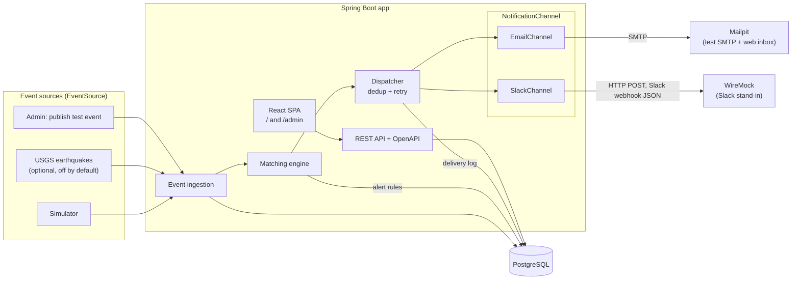
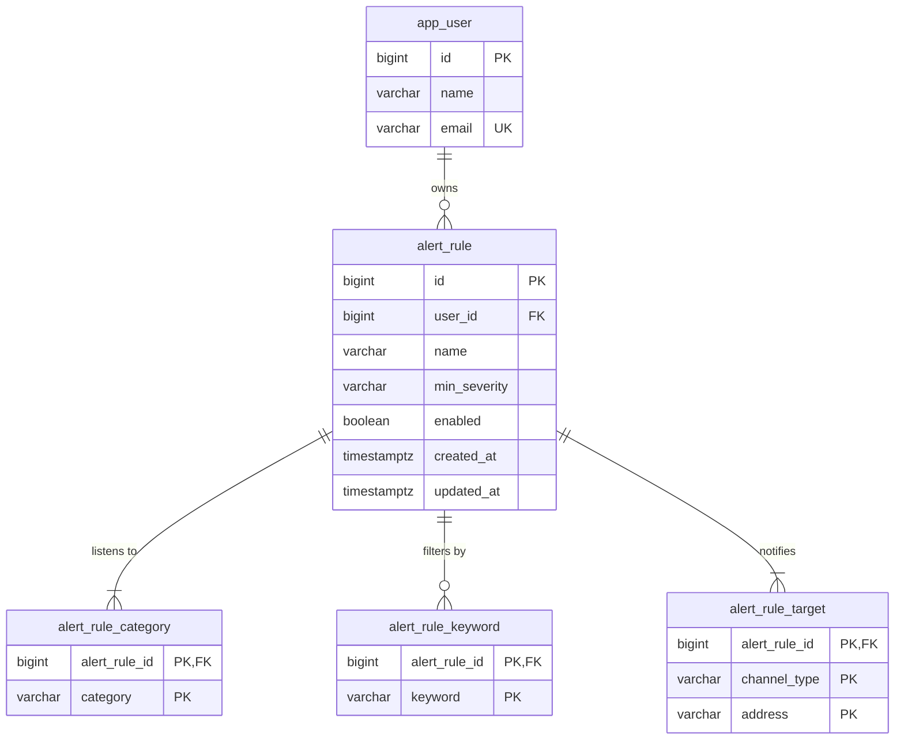

# Architecture

> **Status: M1.** Users and alert rules are implemented (REST API, PostgreSQL schema). Event ingestion, matching, channels and the UI are still the planned design. Each section says which. This document is updated at every milestone to match the code.

## Overview



## Flow of one event

1. An `EventSource` produces an event (category, title, description, severity, source, timestamp).
2. The event is stored.
3. The matching engine selects enabled alert rules whose categories include the event's category, whose minimum severity is at or below the event's severity, and whose keywords (if any) appear in the title or description.
4. For each matching (alert, channel target) pair, the dispatcher checks the delivery log for an existing delivery of this event; if none, it calls the channel.
5. The channel sends the message (SMTP for email, HTTP POST for Slack). Failures are retried up to 3 attempts with backoff.
6. The final status (sent / failed, attempts, error, message body) is written to the delivery log, which users see as their notification history and admins as the delivery log.

## Implemented so far (M1)

### Code layout

The backend is organized by feature (package-by-feature), not by technical layer, so each folder holds everything about one concept.

```
backend/src/main/java/io/github/kisligi/alerts/
├── WorldEventAlertsApplication.java   entry point
├── common/      shared enums (EventCategory, Severity, ChannelType), exceptions,
│                RFC 9457 error mapping (ApiExceptionHandler), OpenAPI info
├── user/        AppUser entity, repository, GET /api/users
└── alert/       AlertRule entity, ChannelTarget, validation, service, REST controller
backend/src/main/resources/
├── application.yaml                   config; every value overridable by env var
└── db/migration/                      Flyway: V1 schema, V2 demo users
```

### REST API

Interactive documentation: Swagger UI at `/swagger-ui.html`, OpenAPI JSON at `/v3/api-docs`.

| Method | Path | What it does |
|--------|------|--------------|
| GET | `/api/users` | List the seeded demo users |
| GET | `/api/users/{userId}/alerts` | List a user's alert rules |
| POST | `/api/users/{userId}/alerts` | Create an alert rule (201 + `Location`) |
| GET | `/api/alerts/{id}` | Get one alert rule |
| PUT | `/api/alerts/{id}` | Replace an alert rule (also used to enable/disable it) |
| DELETE | `/api/alerts/{id}` | Delete an alert rule (204) |

Errors use RFC 9457 problem details (`application/problem+json`): 400 with an `errors` list for validation failures, 400 for an address that does not fit its channel, 404 for unknown users or rules.

Validation rules: name required (≤ 100 chars); at least one category; at most 20 keywords; minimum severity required; 1–10 targets. An `EMAIL` target must look like an email address; a `SLACK` target must be an `http(s)` URL (plain `http` is allowed for the local Slack stand-in). Keywords are trimmed, lower-cased and de-duplicated.

### Database schema (Flyway V1)



Flyway owns the schema; Hibernate runs with `ddl-auto: validate`, so the app refuses to start if entities and schema drift apart.

### Tests

| Test class | Kind | What it covers |
|------------|------|----------------|
| `SeverityTest` | unit | severity ranking |
| `ChannelTargetValidatorTest` | unit (parameterized) | valid and invalid email addresses and webhook URLs |
| `AlertRuleServiceTest` | unit, Mockito | normalization, defaults, unknown user, bad target, update, delete |
| `AlertRuleControllerTest` | `@WebMvcTest` | status codes, `Location` header, validation errors, problem-detail format |
| `AlertApiIntegrationTest` | `@SpringBootTest` + Testcontainers PostgreSQL | Flyway migrations, seeded users, full create/list/update/delete cycle, OpenAPI document |

## Domain model (full target; ✅ = implemented)

| Entity | Key fields |
|--------|------------|
| `AppUser` ✅ | id, name, email (seeded demo users) |
| `AlertRule` ✅ | id, user, name, categories, keywords, minSeverity, enabled, createdAt, updatedAt |
| `ChannelTarget` ✅ | value object inside `AlertRule`: channel type (`EMAIL`, `SLACK`, ...) + address (email or webhook URL) |
| `Event` | id, category, title, description, severity, source, occurredAt, externalId |
| `Delivery` | id, event, alertRule, channel type, address, status, attempts, lastError, body, sentAt; unique (event, alertRule, channel type, address) |
| `ChannelSetting` | channelType, enabled (global admin toggle) |

## Extension points

- **New channel:** implement `NotificationChannel` (its type, and `send(target, event)`), register it as a Spring bean, and add its type to the channel type enum. The dispatcher picks it up automatically. A worked example will be added in M3.
- **New event source:** implement `EventSource` and enable it by configuration.

## Deployment (target, M6)

`docker compose up --build` builds the app image (multi-stage: Node builds the SPA, Maven builds the jar) and starts it with PostgreSQL, Mailpit and WireMock. No API keys or accounts are needed.

See [`decisions.md`](decisions.md) for why each part was chosen.
