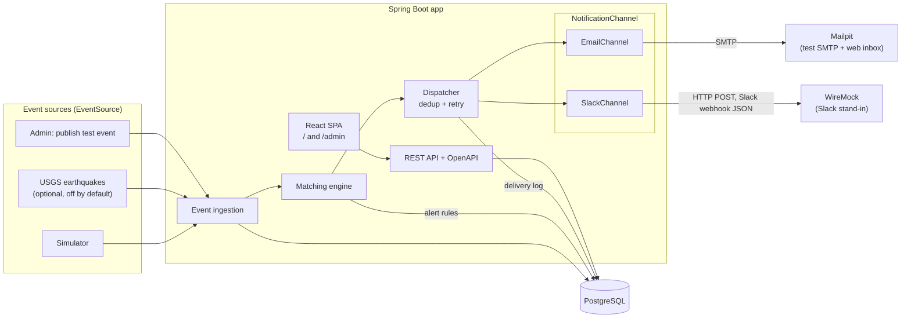

# Architecture

> **Status: planned design (M0).** No code exists yet. This document describes the target design agreed during planning; it is updated at every milestone to match the actual code.

## Overview

## Flow of one event

1. An `EventSource` produces an event (category, title, description, severity, source, timestamp).
2. The event is stored.
3. The matching engine selects enabled alert rules whose categories include the event's category, whose minimum severity is at or below the event's severity, and whose keywords (if any) appear in the title or description.
4. For each matching (alert, channel target) pair, the dispatcher checks the delivery log for an existing delivery of this event; if none, it calls the channel.
5. The channel sends the message (SMTP for email, HTTP POST for Slack). Failures are retried up to 3 attempts with backoff.
6. The final status (sent / failed, attempts, error, message body) is written to the delivery log, which users see as their notification history and admins as the delivery log.

## Planned domain model

| Entity | Key fields |
|--------|------------|
| `User` | id, name, email (seeded demo users) |
| `AlertRule` | id, user, name, categories, keywords, minSeverity, enabled |
| `ChannelTarget` | id, alertRule, channelType (`EMAIL`, `SLACK`, ...), address (email or webhook URL) |
| `Event` | id, category, title, description, severity, source, occurredAt, externalId |
| `Delivery` | id, event, alertRule, channelTarget, status, attempts, lastError, body, sentAt; unique (event, channelTarget) |
| `ChannelSetting` | channelType, enabled (global admin toggle) |

## Extension points

- **New channel:** implement `NotificationChannel` (its type, and `send(target, event)`), register it as a Spring bean, and add its type to the channel type enum. The dispatcher picks it up automatically. A worked example will be added in M3.
- **New event source:** implement `EventSource` and enable it by configuration.

## Deployment (target, M6)

`docker compose up --build` builds the app image (multi-stage: Node builds the SPA, Maven builds the jar) and starts it with PostgreSQL, Mailpit and WireMock. No API keys or accounts are needed.

See [`decisions.md`](decisions.md) for why each part was chosen.
