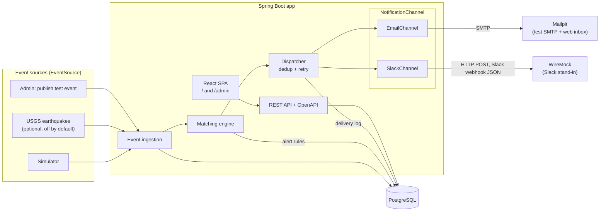
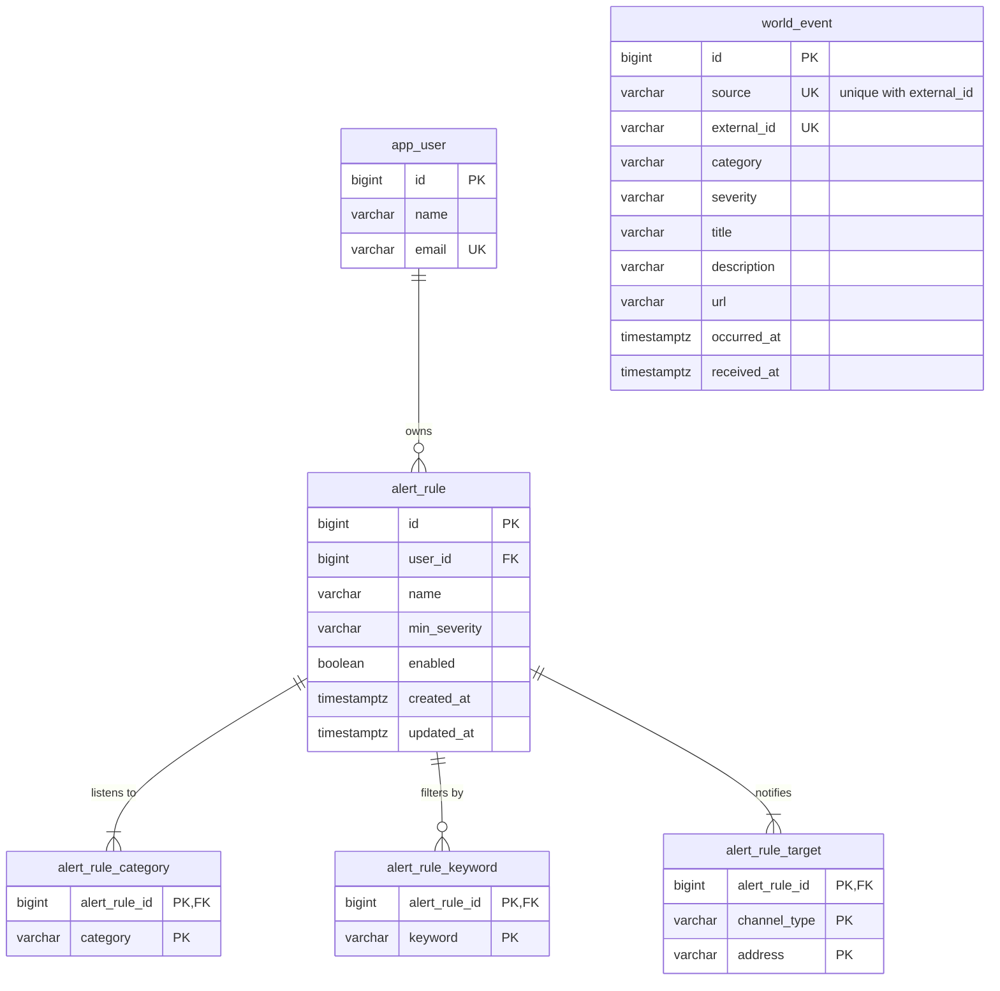

# Architecture

> **Status: M2.** Implemented: users and alert rules (M1); event sources, ingestion and matching (M2). Still planned: notification channels and the delivery log (M3), the UI (M4, M5) and the full compose stack (M6). Each section says which. This document is updated at every milestone to match the code.

## Overview



## Flow of one event

Steps 1–3 are implemented (M2); steps 4–6 come in M3.

1. `EventPoller` asks each enabled `EventSource` for events at the source's interval (or an admin publishes one through `POST /api/admin/events`). Both paths call `EventIngestionService.ingest`.
2. The event is stored once: a repeat with the same `(source, externalId)` is skipped, and a unique constraint backs this up in the database.
3. `AlertRuleRepository.findEnabledByCategory` loads the enabled rules for the event's category; `AlertMatcher` keeps those whose minimum severity is at or below the event's severity and whose keywords (if any) appear in the title or description. If any match, a `WorldEventMatched(eventId, alertRuleIds)` application event is published.
4. For each matching (alert, channel target) pair, the dispatcher checks the delivery log for an existing delivery of this event; if none, it calls the channel.
5. The channel sends the message (SMTP for email, HTTP POST for Slack). Failures are retried up to 3 attempts with backoff.
6. The final status (sent / failed, attempts, error, message body) is written to the delivery log, which users see as their notification history and admins as the delivery log.

## Implemented so far (M1, M2)

### Code layout

The backend is organized by feature (package-by-feature), not by technical layer, so each folder holds everything about one concept.

```
backend/src/main/java/io/github/kisligi/alerts/
├── WorldEventAlertsApplication.java   entry point
├── common/      shared enums (EventCategory, Severity, ChannelType), exceptions,
│                RFC 9457 error mapping (ApiExceptionHandler), OpenAPI info
├── user/        AppUser entity, repository, GET /api/users
├── alert/       AlertRule entity, ChannelTarget, validation, service, REST controller
├── event/       WorldEvent entity, ingestion service, WorldEventMatched, events REST API
│   └── source/  EventSource interface, simulator, USGS adapter, poller, source config
└── matching/    AlertMatcher: the matching rules in one place
backend/src/main/resources/
├── application.yaml                   config; every value overridable by env var
└── db/migration/                      Flyway: V1 users and rules, V2 demo users, V3 events
```

### REST API

Interactive documentation: Swagger UI at `/swagger-ui.html`, OpenAPI JSON at `/v3/api-docs`.

| Method | Path | What it does |
|--------|------|--------------|
| GET | `/api/users` | List the seeded demo users |
| GET | `/api/users/{userId}/alerts` | List a user's alert rules |
| POST | `/api/users/{userId}/alerts` | Create an alert rule (201 + `Location`) |
| GET | `/api/alerts/{id}` | Get one alert rule |
| PUT | `/api/alerts/{id}` | Replace an alert rule (also used to enable/disable it) |
| DELETE | `/api/alerts/{id}` | Delete an alert rule (204) |
| GET | `/api/events?limit=50` | Most recent events, newest first (`limit` 1–200) |
| POST | `/api/admin/events` | Publish a test event; runs the normal ingestion and matching and returns the matched rule ids (201) |

Errors use RFC 9457 problem details (`application/problem+json`) everywhere, including Spring's own errors such as malformed JSON or an out-of-range query parameter: 400 with an `errors` list for body validation failures, 400 for an address that does not fit its channel, 404 for unknown users or rules.

Validation rules: name required (≤ 100 chars); at least one category; at most 20 keywords; minimum severity required; 1–10 targets. An `EMAIL` target must look like an email address; a `SLACK` target must be an `http(s)` URL (plain `http` is allowed for the local Slack stand-in). Keywords are trimmed, lower-cased and de-duplicated.

### Event sources

| Source | Default | Interval | What it produces |
|--------|---------|----------|------------------|
| `SimulatedEventSource` (`SIMULATOR`) | on | 30 s | one random event from a 12-entry catalog that covers every category × severity, labelled `[SIMULATED]` |
| `UsgsEarthquakeSource` (`USGS`) | off | 5 min | real earthquakes from the USGS 4.5+ past-day GeoJSON feed; severity from magnitude: < 5 LOW, < 6 MEDIUM, < 7 HIGH, ≥ 7 CRITICAL |
| Admin API (`ADMIN`) | always | on demand | whatever the admin publishes |

A failing source is logged and retried at its next poll; it never stops other sources. One event that cannot be stored never stops the rest of its batch.

### Database schema (Flyway V1, V3)



`world_event` is not linked to rules by a foreign key: which rules an event matched is computed at ingestion time and will be recorded per delivery in M3.

Flyway owns the schema; Hibernate runs with `ddl-auto: validate`, so the app refuses to start if entities and schema drift apart.

### Tests

| Test class | Kind | What it covers |
|------------|------|----------------|
| `SeverityTest` | unit | severity ranking |
| `ChannelTargetValidatorTest` | unit (parameterized) | valid and invalid email addresses and webhook URLs (scheme case, missing host) |
| `AlertRuleServiceTest` | unit, Mockito | normalization, defaults, unknown user (create and list), bad target, update replaces collections, update/delete of missing rule, delete |
| `AlertRuleControllerTest` | `@WebMvcTest` | status codes, `Location` header, every request constraint, malformed JSON, business-rule 400 and 404 problem details, ISO timestamps |
| `AlertApiIntegrationTest` | `@SpringBootTest` + Testcontainers PostgreSQL | Flyway migrations, seeded users, full create/read/update/delete cycle with timestamps, per-user isolation, invalid target not stored, no orphan rows after delete, OpenAPI document |
| `AlertMatcherTest` | unit (parameterized) | every matching rule: category, severity boundaries, keyword case and substring, title or description, empty keywords, disabled rule |
| `WorldEventTest` | unit | default and truncated `occurredAt`, searchable text |
| `EventIngestionServiceTest` | unit, Mockito, real matcher | duplicates skipped before saving, no duplicate check without external id, only fitting rules announced, nothing announced without a match |
| `SimulatedEventSourceTest` | unit | catalog covers all 12 category × severity pairs, one labelled event per poll, unique ids, seed gives repeatable output |
| `UsgsEarthquakeSourceTest` | unit, `MockRestServiceServer`, fixture from the real feed | field mapping, title fallback, tsunami flag, skipped incomplete features, empty feeds, server error, magnitude → severity boundaries |
| `EventPollerTest` | unit, Mockito | failing source does not stop polling, one bad event does not stop the batch, duplicates not counted, each source scheduled at its own interval |
| `EventSourceConfigTest` | `ApplicationContextRunner` | defaults (simulator on, USGS off) and switching them by properties |
| `EventControllerTest` | `@WebMvcTest` | admin publish → ingestion with source `ADMIN` and trimmed title, validation errors, default and out-of-range `limit` as problem details |
| `EventIngestionIntegrationTest` | `@SpringBootTest` + Testcontainers PostgreSQL | admin event matches exactly the fitting rules (each other rule fails on one criterion) and `WorldEventMatched` is published, duplicates stored once, unique constraint, simulator events fit the schema, newest-first listing |

102 tests; line coverage 99.4%, branch coverage 98.7% (JaCoCo). What is left uncovered and why: [`dev-journal.md`](dev-journal.md).

## Domain model (full target; ✅ = implemented)

| Entity | Key fields |
|--------|------------|
| `AppUser` ✅ | id, name, email (seeded demo users) |
| `AlertRule` ✅ | id, user, name, categories, keywords, minSeverity, enabled, createdAt, updatedAt |
| `ChannelTarget` ✅ | value object inside `AlertRule`: channel type (`EMAIL`, `SLACK`, ...) + address (email or webhook URL) |
| `WorldEvent` ✅ | id, source, externalId, category, severity, title, description, url, occurredAt, receivedAt |
| `Delivery` | id, event, alertRule, channel type, address, status, attempts, lastError, body, sentAt; unique (event, alertRule, channel type, address) |
| `ChannelSetting` | channelType, enabled (global admin toggle) |

## Extension points

- **New channel:** implement `NotificationChannel` (its type, and `send(target, event)`), register it as a Spring bean, and add its type to the channel type enum. The dispatcher picks it up automatically. A worked example will be added in M3.
- **New event source:** implement `EventSource` (`name()`, `pollInterval()`, `poll()`), register it as a bean, usually behind an `alerts.sources.<name>.enabled` property in `EventSourceConfig`. `EventPoller` picks it up; return a stable `externalId` so repeats are ignored. `UsgsEarthquakeSource` is the worked example.

## Deployment (target, M6)

`docker compose up --build` builds the app image (multi-stage: Node builds the SPA, Maven builds the jar) and starts it with PostgreSQL, Mailpit and WireMock. No API keys or accounts are needed.

See [`decisions.md`](decisions.md) for why each part was chosen.
